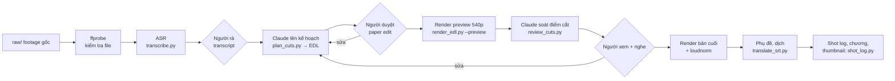

# Phần 2 — Cách dùng AI dựng video hiệu quả

Phần này rút ra từ cách các dự án thực tế (video-use, MCP của DaVinci Resolve, Remotion
Agent Skills) đang vận hành, và từ chính các script trong thư mục [`examples/`](../examples).

---

## 1. Mười nguyên tắc

### 1) Transcript là bề mặt chính, hình ảnh chỉ lấy khi cần
Đưa cho Claude transcript có mốc thời gian (rẻ, gọn, đọc được cả buổi nói dài). Chỉ trích
khung hình ở những chỗ cần quyết định bằng mắt: chuyển cảnh, chọn thumbnail, kiểm tra
điểm cắt, chọn giữa hai lần quay. Với video ít lời (vlog du lịch, thể thao), làm ngược lại:
shot log từ khung hình là bề mặt chính.

### 2) AI chọn, code tính
Đừng để LLM tự viết `00:03:17.420`. Hãy chia transcript thành các cụm có ID (`P0042`), để
Claude trả về **dải ID cần giữ**, rồi để code đổi ID thành thời gian, đặt điểm cắt vào
khoảng lặng giữa hai từ và chừa một chút "hơi thở". Cách này loại bỏ hẳn lỗi timestamp
bịa và lỗi cắt giữa từ. Xem `plan_to_segments()` trong
[`examples/plan_cuts.py`](../examples/plan_cuts.py).

### 3) Bắt buộc đầu ra có cấu trúc
Dùng structured outputs (JSON Schema hoặc Pydantic) để Claude luôn trả JSON đúng mẫu: EDL,
shot log, danh sách phụ đề. Không phải "bóc" JSON từ văn bản tự do, và kiểm tra được ngay
(ID có tồn tại không, có thiếu dòng phụ đề nào không).

### 4) Kế hoạch trước, người duyệt, rồi mới render
Quy trình nên đi theo vòng *hỏi → xác nhận → thực hiện → tự kiểm tra → ghi lại*. Claude đưa
ra paper edit (đoạn nào, vì sao, tổng thời lượng); bạn sửa EDL nếu cần; sau đó mới render.
Sửa một dòng JSON rẻ hơn nhiều so với render lại video 4K.

### 5) Không phá huỷ footage gốc
`raw/` chỉ đọc. Mọi kết quả ghi vào `work/` và `out/`, đặt tên theo phiên bản. Script
`render_edl.py` từ chối ghi đè file nguồn.

### 6) Preview rẻ trước, bản cuối sau
Render bản 540p, `preset veryfast` để duyệt nội dung. Chỉ render chất lượng cao khi đã chốt.

### 7) Tự kiểm tra có hệ thống
Sau mỗi lần render:
- so độ dài thực tế với độ dài dự kiến;
- trích khung trước/sau mỗi điểm cắt để soát jump cut và khung đen
  ([`review_cuts.py`](../examples/review_cuts.py));
- **người nghe lại các điểm cắt**, vì AI không phát hiện được tiếng "bụp" hay hơi thở bị cụt.

### 8) Brief cụ thể thay cho câu lệnh chung chung
"Cắt cho hay" sẽ cho ra kết quả trung bình. Một brief tốt nêu rõ mục tiêu, khán giả, nền
tảng, độ dài, hook, những gì bắt buộc giữ hoặc bỏ, nhịp dựng và tiêu chí "đạt". Xem mẫu ở
[`templates/brief.md`](../templates/brief.md).

### 9) Chia nhỏ việc, mỗi bước có đầu ra kiểm chứng được
Chép lời → rà transcript → lập shot log → chọn đoạn → sắp mạch → cắt tinh → phụ đề → âm
thanh → xuất file. Mỗi bước có file kết quả riêng để xem và sửa. Một câu lệnh "làm hết từ A
đến Z" khó kiểm soát và khó sửa.

### 10) Chọn đúng công cụ cho từng lớp, và đo thật
Claude cho phần suy luận và điều phối; ASR cho phần nghe; ffmpeg/NLE cho phần thực thi;
model tạo sinh cho phần pixel. Ghi lại thời gian và chi phí thực tế (script in số token sau
mỗi lần gọi) để biết AI có thật sự tiết kiệm cho bạn không.

---

## 2. Quy trình mẫu (video có lời thoại: phỏng vấn, podcast, bài giảng, talking head)

| Bước | Ai làm | Công cụ | Đầu ra |
|---|---|---|---|
| 1. Kiểm tra file | Máy | `ffprobe` | Độ dài, độ phân giải, fps, số track âm thanh |
| 2. Chép lời | Máy | faster-whisper / ElevenLabs Scribe / WhisperX | `*.transcript.json` có mốc thời gian từng từ |
| 3. Rà transcript | Người (5–10 phút) | Trình soạn thảo | Sửa tên riêng, thuật ngữ |
| 4. Lên kế hoạch | Claude | `plan_cuts.py` | EDL + paper edit + cảnh báo |
| 5. Duyệt | Người | Đọc paper edit, sửa JSON | EDL đã chốt |
| 6. Preview | Máy | `render_edl.py --preview` | `preview.mp4` + `.srt` |
| 7. Soát lỗi | Claude + người | `review_cuts.py` + tai nghe | Danh sách điểm cần che (punch-in, b-roll) |
| 8. Bản cuối | Máy | `render_edl.py` + `loudnorm` | `final.mp4` |
| 9. Hậu kỳ nội dung | Claude | `translate_srt.py`, `shot_log.py` | Phụ đề đa ngôn ngữ, chương, thumbnail |

Video ít lời (du lịch, sự kiện, B-roll): đổi bước 2–4 thành *shot log bằng khung hình*
(`shot_log.py --scenes`), rồi để Claude chọn cảnh theo số khung, và dựng theo nhịp nhạc.

---

## 3. Chọn công cụ theo loại video

| Loại video | Cách làm nên chọn | Lý do |
|---|---|---|
| Podcast, phỏng vấn, bài giảng | Transcript trước: Descript, video-use, hoặc pipeline trong repo này | Lời nói mang nội dung; cắt theo câu là chính |
| Video dài → nhiều clip ngắn | OpusClip/CapCut cho nhanh; Claude + script nếu cần kiểm soát gu và brief | Công cụ chuyên dụng nhanh; Claude chọn đoạn "đúng ý" hơn khi có brief kỹ |
| Highlight sự kiện trên project có sẵn | DaVinci Resolve 21.1 Studio + Claude qua MCP | Thao tác trực tiếp trên timeline, bin và render queue |
| Motion graphics, video giải thích, biểu đồ động, intro/outro | Claude Code + Remotion (Agent Skills) | Video là code React: chính xác, sửa được, tái sử dụng |
| Đổi kích thước, phiên bản cho mạng xã hội | Connector Adobe for creativity, CapCut, hoặc ffmpeg | Việc lặp lại, ít cần sáng tạo |
| Phim, quảng cáo cao cấp | Người dựng trên NLE; AI chỉ chép lời, ghi log, tìm cảnh, làm phụ đề | Gu và nhịp là giá trị chính |

---

## 4. Mẹo khi làm việc với Claude

1. **Đặt dữ liệu dài trước, câu hỏi sau.** Transcript hoặc khung hình đặt trước, brief và
   yêu cầu đặt cuối. Gắn nhãn từng ảnh (`Khung 12 — 01:05`) để Claude nhắc lại chính xác.
2. **Bọc dữ liệu bằng thẻ**: `<brief>…</brief>`, `<transcript>…</transcript>`, giúp Claude
   tách rõ chỉ dẫn và dữ liệu.
3. **Yêu cầu Claude nêu điều không chắc chắn** (trường `warnings`): tên riêng nghi sai, hai
   lần nói gần giống nhau, chỗ cần b-roll.
4. **Nhắc giới hạn của khung hình:** "khung hình chỉ là mẫu thưa, đừng đoán sự kiện giữa hai
   khung". Cách này giảm hẳn mô tả bịa.
5. **Không yêu cầu nhận diện người thật.** Claude không nêu danh tính người trong ảnh. Hãy mô
   tả theo vai trò ("người dẫn áo xanh") hoặc dùng công cụ gom mặt riêng.
6. **Chỉnh mức `effort`:** `high` cho việc chọn đoạn, sắp mạch (cần suy luận); `low` hoặc
   `medium` cho dịch phụ đề, shot log khối lượng lớn.
7. **Lặp theo phản hồi cụ thể:** "đoạn 3 dài quá, giữ câu cuối thôi", "đưa câu về khoản nợ
   lên làm hook". Phản hồi cụ thể hiệu quả hơn "làm lại hay hơn".
8. **Ghi nhớ quyết định** vào `project.md` để buổi sau Claude Code không phải hỏi lại.

---

## 5. Checklist chất lượng trước khi xuất bản

- [ ] Độ dài đúng mục tiêu; hook nằm trong 3–5 giây đầu
- [ ] Không cắt giữa từ; không có tiếng "bụp" tại điểm cắt (đã nghe bằng tai nghe)
- [ ] Jump cut lộ liễu đã được che (punch-in 110–120%, b-roll hoặc chuyển cảnh)
- [ ] Không có khung đen hay khung chớp
- [ ] Phụ đề khớp lời, đúng chính tả tên riêng, tốc độ đọc ≤ khoảng 20 ký tự/giây
- [ ] Loudness đúng chuẩn nền tảng (YouTube khoảng -14 LUFS)
- [ ] Nhạc, font, stock có giấy phép; logo đúng phiên bản
- [ ] Không lộ thông tin nhạy cảm (màn hình, email, biển số xe...)
- [ ] Đã gắn nhãn nội dung do AI tạo nếu nền tảng yêu cầu
- [ ] Người có trách nhiệm đã xem bản cuối

---

## 6. Quyền riêng tư và đạo đức

- Hỏi ý kiến người xuất hiện trong video trước khi đưa footage lên dịch vụ AI trên mây.
- Dữ liệu nhạy cảm: chạy ASR local (faster-whisper), chỉ gửi transcript hoặc khung hình đã
  lọc cho Claude.
- Không dùng AI để thay đổi lời nói, khẩu hình hay giọng của người thật khi họ chưa cho phép.
- Giữ lại EDL và nhật ký `project.md` để truy vết ai đã quyết định cắt gì, khi nào.
