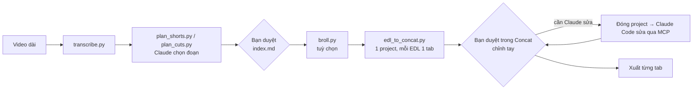

# Phần 5 — Đánh giá: Claude Code + Concat cho video dài

**Câu hỏi:** dùng Claude Code và Concat để tạo project từ video dài, sau đó người duyệt
trên Concat rồi xuất video, có khả thi không?

**Kết luận:** khả thi và hợp nhu cầu, với điều kiện chia việc đúng chỗ:

| Việc | Ai / công cụ |
|---|---|
| Chép lời có mốc thời gian từng từ | `transcribe.py` (Whisper của Concat không gọi được qua MCP) |
| Chọn đoạn, chọn short, chọn ô B-roll | Claude: `plan_cuts.py`, `plan_shorts.py`, `broll.py` |
| Dựng project Concat từ các EDL | `edl_to_concat.py`: cố định, nhanh, không tốn token |
| Soát khung hình, sửa nhỏ bằng lời | Claude Code qua MCP `concat` (`preview_frame`, `clip_transform`...) |
| Duyệt, chỉnh tay, xuất | Bạn, trên giao diện Concat |

Đánh giá dựa trên mã nguồn Concat (bản phát hành v0.2.8 ngày 18/10/2026 và nhánh chính
đến 28/10/2026). Chưa chạy được Concat thật trong môi trường đã viết tài liệu này; xem mục
"Mức độ kiểm chứng" ở cuối.

---

## 1. Quy trình đề xuất



```powershell
& $py "$ex\plan_shorts.py" work\podcast.transcript.json -o shorts --count 8 --min 25 --max 55 --brief "..."
& $py "$ex\edl_to_concat.py" "shorts\*.edl.json" --name podcast_shorts --aspect 9:16 --hook --dry-run
& $py "$ex\edl_to_concat.py" "shorts\*.edl.json" --name podcast_shorts --aspect 9:16 --hook
```

Kết quả: thư mục `shorts\podcast_shorts`. Mở trong Concat, mỗi short là một tab:

| Lane (từ dưới lên) | Nội dung |
|---|---|
| Lane chính | Các đoạn của EDL nối liền, fade âm 30 ms ở mỗi điểm cắt; khung dọc dùng `fill` (theo `--focus`) hoặc nền mờ (`--fit blur`) |
| Lane B-roll | Các mục `broll` của EDL, tắt tiếng, phủ kín khung |
| Lane phụ đề | Phụ đề khớp timeline mới, font Hanken Grotesk (đủ dấu tiếng Việt) |
| Lane hook | Chữ hook 2,5 giây đầu |

---

## 2. Vì sao cách này làm được (căn cứ trong mã nguồn)

- **Nhiều timeline trong một project:** lệnh `addTimeline`, `renameTimeline`,
  `setTimelineVideo` (mỗi tab một kích thước khung). Một video dài thành một project gồm nhiều
  tab, duyệt ở một chỗ.
- **Dựng gọn:** `addClipsInSequence` đặt cả video nguồn N lần nối nhau trong một lệnh; sau đó
  một lệnh gộp (`batch`) cắt đầu và cuối từng bản kiểu ripple. Concat ghi rõ: cắt đầu kiểu
  ripple giữ nguyên vị trí clip, chỉ dời điểm vào trong nguồn, và kéo các clip phía sau. Vì
  vậy lane chính chỉ cần khoảng 3 lượt gọi dù EDL có bao nhiêu đoạn. Một `batch` là một bước
  undo và hoặc thành công hết, hoặc không đổi gì.
- **Tự kiểm tra:** `edl_to_concat.py` đọc lại timeline và so từng đoạn (điểm vào trong nguồn,
  độ dài, vị trí) với EDL; tab nào lệch được đánh dấu "CẦN KIỂM TRA".
- **Claude tự sửa được:** lệnh sai bị từ chối kèm câu giải thích; `preview_frame` cho Claude
  xem khung hình đã ghép hoàn chỉnh (chữ, hiệu ứng) trước khi giao bạn.
- **Phụ đề là chữ trên timeline:** sửa chính tả, đổi kiểu cả lane ngay trong giao diện.
- **Miễn phí, chạy trên máy:** footage không bị tải lên đâu; chỉ transcript được gửi cho Claude.

---

## 3. Hạn chế và cách xử lý

| Hạn chế | Ảnh hưởng | Cách xử lý |
|---|---|---|
| Project đang mở trên Concat thì agent không ghi được; chưa có "live mode" | Mỗi vòng nhờ Claude sửa phải đóng rồi mở lại project | Gom yêu cầu sửa vào `review.md`, để Claude làm một lượt |
| Nhiều font đi kèm thiếu dấu tiếng Việt (Bebas Neue, Archivo Black, Permanent Marker, Staatliches...) | Chữ bị lẫn font hệ thống | Dùng Hanken Grotesk, Inter, Montserrat, Space Grotesk, Anton, Bangers, Lobster, Pacifico, Black Ops One |
| v0.2.8: `title_add` không ghi font sẽ dùng font không có sẵn | Báo FONT NOT FOUND | Luôn ghi `fontFamily` (script đã làm) |
| v0.2.8: chưa có linkage | Cắt ripple ở lane chính không kéo phụ đề, B-roll theo | Script dựng lane chính trước; khi tự cắt trong giao diện, chọn cả các lane liên quan |
| v0.2.8: file `.ts`/`.mpg` có thể trễ tiếng sau điểm cắt | Lệch tiếng | `ffmpeg -i in.ts -c copy in.mp4` trước khi dựng |
| v0.2.8 trên Windows: hiệu ứng halation lỗi GPU | Lỗi khi dùng hiệu ứng đó | Tránh dùng cho tới bản sau |
| Mỗi lệnh sửa qua MCP trả về toàn bộ timeline đang mở | Claude Code tốn token khi timeline có hàng trăm dòng phụ đề | Dựng bằng script; Claude Code chỉ sửa nhỏ |
| Concat còn beta, API đổi nhanh | Script có thể cần chỉnh theo phiên bản | Gọi `concat_version` trước; báo lỗi để cập nhật script |
| Chỉ ghi file trong thư mục người dùng; mỗi lúc xuất một video | — | Đặt dự án trong `C:\Users\<bạn>\...`; xuất lần lượt từng tab |

Bản đang phát triển của Concat (chưa phát hành) đã thêm `timeline_linkage` (phụ đề, B-roll
dịch theo khi cắt lane chính), `title_style_words` (tô màu vài chữ trong phụ đề), phím Up/Down
nhảy tới điểm cắt, và sửa các lỗi ở bảng trên.

---

## 4. Ước lượng cho podcast 60 phút ra 8 short

| Bước | Chi phí / công sức |
|---|---|
| Chép lời local | Tuỳ máy (GPU nhanh hơn nhiều) |
| `plan_shorts.py` (Claude Opus 5.5, effort high) | Thường dưới 1 USD |
| `edl_to_concat.py` | Không tốn token; khoảng 10–15 lượt gọi MCP mỗi tab |
| Claude Code soát và sửa nhỏ | Tính vào gói Claude Code |
| Bạn duyệt và xuất | Thời gian của bạn |

---

## 5. Mức độ kiểm chứng

- **Đã kiểm chứng:** tên công cụ, tên lệnh và tên trường JSON đối chiếu trực tiếp với mã
  nguồn v0.2.8; toàn bộ luồng của `edl_to_concat.py` chạy với một server MCP giả lập mô phỏng
  các quy tắc cắt ripple, lane và chữ của Concat (`tests/fake_concat_mcp.py`, có test tự động).
- **Chưa kiểm chứng:** chạy với Concat thật. Lần chạy đầu trên máy của bạn:
  1. `--dry-run` để xem kế hoạch;
  2. chạy thật với 1 EDL ngắn; xem các dòng `[OK]` / `CẦN KIỂM TRA`;
  3. mở project trong Concat, phát thử vài điểm cắt;
  4. nếu lỗi, gửi lại thông báo lỗi (script in cả log của Concat) để chỉnh script.
